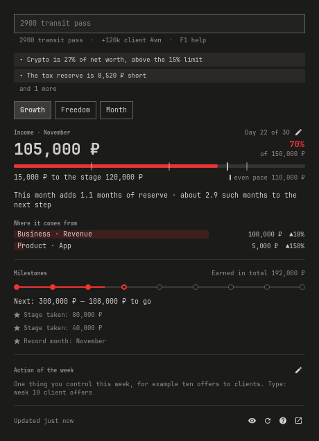
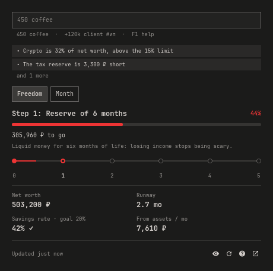
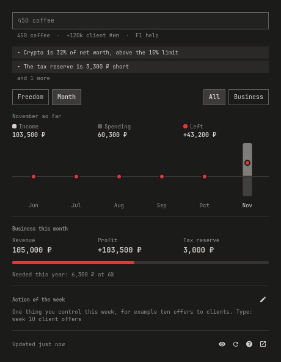
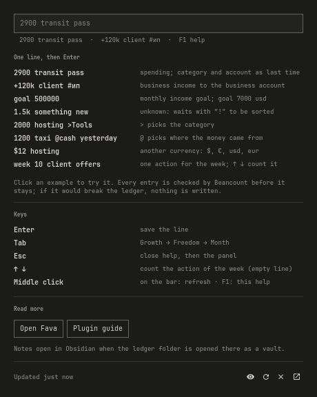

# Beancount Bar

Your [Beancount](https://github.com/beancount/beancount) ledger in the [Omarchy](https://omarchy.org) bar: a freedom ladder, runway, savings rate and one-line entry with undo. It runs a small local command, `fin`. No network, no keys, no server: the ledger stays plain text in your own folder.

This is an unofficial plugin and is not affiliated with the Beancount or Fava projects.

| Growth | Freedom | Month | Help |
| --- | --- | --- | --- |
|  |  |  |  |

## What you get

- **In the bar:** an icon that grows with everything you have earned (sprout → coins at 100 000 → gold at 1 000 000 → diamond at 10 000 000; it never goes back), then this month's income and the goal, for example `105k · 70%`, or against last month (`42k ▲18%`), or `★` for a record month. Never red: a slow start of the month is not a failure.
- **Growth:** income this month as a race. With a goal: stages, an even-pace mark and how much is left to the next stage. Without one: the same day of last month and the best month. Below: where the money comes from, what this month adds to your reserve, lifetime milestones and recent wins. Each new win gets one notification.
- **Freedom ladder:** 0 no debt with interest → 1 reserve of 6 months → 2 reserve of 12 months → 3 assets pay 25% of spending → 4 assets pay the fixed costs → 5 freedom capital (a year of spending divided by a 3.5% withdrawal rate). The numbers come from your ledger, not from the plugin.
- **Four numbers:** net worth, runway, savings rate against your goal, income from assets per month.
- **Month:** six months of income and spending, or business revenue and costs; the business this month with a tax reserve; one action of the week with a counter.
- **One-line entry:** type, check the preview, press Enter. Undo from the panel or the notification.
- **Fava** one click away as a web app.
- **Help** behind the ? button or F1: the entry line with clickable examples, the keys, and links to your own notes in Obsidian (a guide, a constitution, the ladder, an investment policy, whichever exist next to the ledger).

## Install

```sh
omarchy plugin add https://github.com/andreiyurik/omarchy-beancount-bar
omarchy plugin enable andreiyurik.beancount-bar right
```

Then point the plugin at a `fin` command (widget settings → `fin command`). The plugin ships a reference one in `cli/`:

```sh
ln -s ~/.config/omarchy/plugins/andreiyurik.beancount-bar/cli/fin ~/.local/bin/fin
```

`fin` reads the ledger from `~/finance/ledger/main.bean`; set `FIN_ROOT` to use another folder. `FIN_TODAY=YYYY-MM-DD` makes it work as if it were that day (tests, demos, screenshots).

It needs [uv](https://docs.astral.sh/uv/), which fetches Beancount 3.2.3 on first run. `cli/example/` is a starting ledger with the account layout the reference `fin` expects; copy it and replace the made-up entries.

The Omarchy shell does not read your shell profile. If your ledger is not in `~/finance`, give the setting a small wrapper script that exports `FIN_ROOT` and runs `fin`.

## One-line entry

```
AMOUNT [CURRENCY] description [@from] [>category] [#tag] [yesterday]
```

| Line | Means |
| --- | --- |
| `2900 transit pass` | spending; category and account as last time for “transit pass” |
| `1,5k something new` | unknown: goes to `Expenses:Uncategorized` with a `!` flag, to sort later |
| `+120k client #ип` | income of the business (the tag is set in the ledger) |
| `2000 hosting #ип >Tools` | `>` picks a category; with the business tag, business accounts win |
| `12 usd hosting`, `$12 hosting` | another currency |
| `2900 transit pass @cash yesterday` | `@` picks the account by its `short:` alias or name |
| `week 10 client offers` | sets the action of the week; ↑ and ↓ count it |
| `goal 500000`, `goal 7000 usd`, `goal off` | the monthly income goal |

Every entry goes to `ledger/inbox.bean` and is checked by Beancount before it stays. If the ledger would break, nothing is written.

Keys: Enter saves, Tab switches Freedom and Month, F1 opens help, Esc closes, ↑/↓ on an empty line count the action of the week, middle click on the bar refreshes.

## Settings

| Setting | Default | |
| --- | --- | --- |
| `command` | `fin` | the command that answers the contract below |
| `favaUrl` | `http://localhost:5000` | opened as a web app |
| `barShows` | `growth` | `growth`: income and the goal; `freedom`: the ladder step |
| `language` | `auto` | `auto` follows Omarchy; `ru` or `en` shows only this panel in that language |
| `autoRefresh`, `refreshMinutes` | on, 10 | background refresh |

## Notes in Obsidian

`fin status` lists the notes it finds next to the ledger (`README.md`, `00 Конституция.md`, `01 Инвестиционная политика.md`, `02 Лестница свободы.md` in the reference `fin`). The help view opens them with `obsidian://open?path=…`, which works once that folder is opened in Obsidian as a vault.

## The `fin` contract

The plugin calls only these, with arguments as a list, never through a shell. Any program that answers them works, so you can wrap hledger or anything else.

| Call | Answer (JSON on stdout, `"schema": 1`) |
| --- | --- |
| `fin status --json` | numbers, ladder, months, warnings, week, and `entry` (accounts with `short` aliases, history of descriptions) |
| `fin add --json -- "<line>"` | `{"ok": true, "entry": {id, date, amount, currency, narration, account, source, income}}` |
| `fin undo --json <id>` | `{"ok": true, "narration": ...}` |
| `fin week --json -- <target> <text…>` / `+1` / `-1` / `clear` | `{"ok": true, "week": {...}}` |
| `fin goal --json -- <amount> [currency]` / `off` | `{"ok": true, "goal": {amount, currency}}` |

On failure: exit code 1 and `{"schema": 1, "ok": false, "error": "<code>", "message": "..."}`. The exact fields are in `cli/fin.py` (`status()`), and `tests/contract.test.js` runs the panel's preview and `fin.py` on the same lines.

## Optional hotkey

Add to `~/.config/hypr/bindings.lua`:

```lua
o.bind("SUPER + ALT + M", "Finance panel", "omarchy-shell shell toggle andreiyurik.beancount-bar")
```

## Privacy

- Nothing leaves your computer. The plugin starts `fin` and reads what it prints.
- The eye button hides amounts, for screen sharing. The choice is kept in `~/.config/beancount-bar/hide-amounts`.
- Text from the ledger is always shown as plain text.

## Why it looks like this

The ladder, the single action of the week and the absence of red follow research on goals rather than games: visible progress toward the next step (goal-gradient, Kivetz, Urminsky and Zheng, 2006), one concrete intention (Gollwitzer, 1999), and no daily score to check (myopic loss aversion, Benartzi and Thaler, 1995). These informed the design; they are not proof that it works for you. Points, streaks and badges are left out on purpose.

## Tests

```sh
node tests/model.test.js      # parsing and formatting
node tests/project.test.js    # catalogs, plain text, theme colors, no shell
node tests/contract.test.js   # the panel and fin.py read lines the same way (needs uv)
node tests/render.js out/     # renders the panel offscreen with Omarchy's shell (local only)
```

## License

MIT
